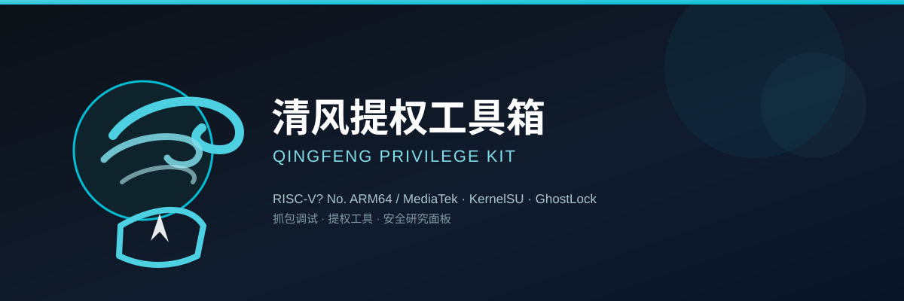

  

<h3 align="center">清风南辞 · Android 内核安全 / App 开发</h3>

  
  
  
  

---

## 📦 项目

<table>
<tr>
  <td align="center" width="50%">
    <strong>🧰 清风工具箱 · qingfeng-kit</strong>  
    多合一 Android 工具 App（Compose 原生）  
    <a href="https://github.com/qingfengOfficial/qingfeng-kit"><b>仓库 →</b></a> ·
    <a href="https://github.com/qingfengOfficial/qingfeng-kit/releases"><b>下载 →</b></a>
  </td>
  <td align="center" width="50%">
    <strong>🔧 清风提权工具箱 · qingfeng-toolbox</strong>  
    Android 终端 / 抓包 / 提权辅助面板  
    <a href="https://github.com/qingfengOfficial/qingfeng-toolbox"><b>仓库 →</b></a> ·
    <a href="https://github.com/qingfengOfficial/qingfeng-toolbox/releases"><b>下载 →</b></a>
  </td>
</tr>
</table>

## 🚀 正在做

- **Android 内核安全研究**：KernelSU / GhostLock 相关提权链路（iQOO Z10 Turbo Pro · PD2322）
- **清风工具箱迭代**：当前 v2.2 聚焦书源引擎（Legado 全源码移植）与音乐音源生态

## 🛠 技术栈

`Kotlin` · `Jetpack Compose` · `Material 3` · `Room` · `Glance(桌面组件)` · `QuickJS(脚本引擎)` · `Legado 书源引擎` · `ffmpeg-kit` · `PDFBox` · `OkHttp`

## 📈 仓库状态

<!-- 注意：github-readme-stats 卡片不支持组织(Organization)账号时可能显示异常，
     若本账号为组织，请删除下面三行卡片。 -->

  
  

---

<h6 align="center">Debug 于昼 · Reverse 于夜 · 风起内核深处</h6>